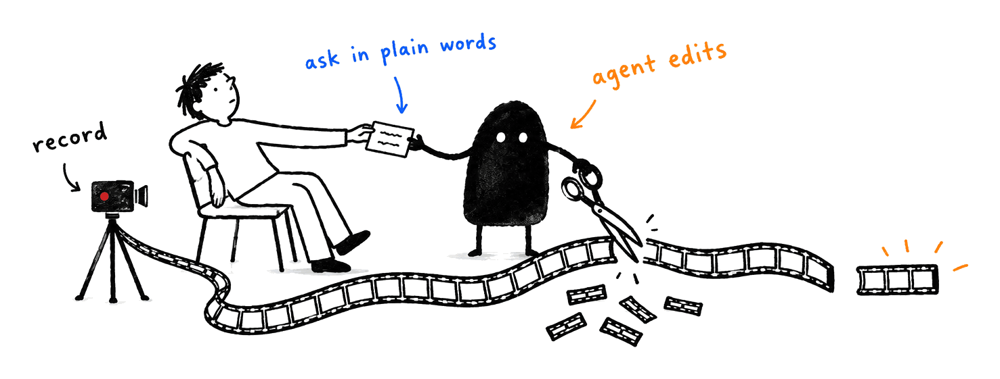
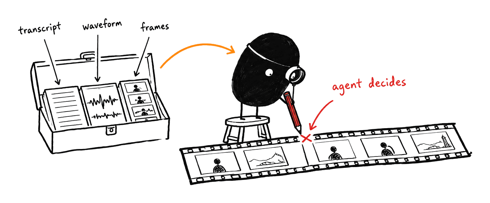
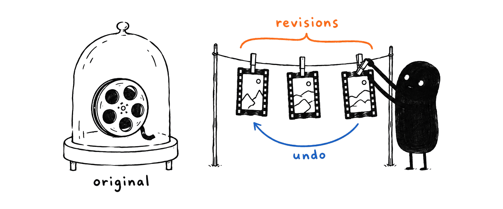

<p align="center">
  
</p>

<p align="center">
  <a href="https://github.com/dzhng/yap/releases/latest"></a>
  
  
  
</p>

---

**Just yap. Your agent gets it.**

Some ideas are faster to show than to write: a bug you can see, a design you
want changed, a product you want to demo, an update for your team. With Yap you
just talk and show. Your agent, **Claude Code, Codex or any agent harness**,
gets the recording with the eyes, ears and hands to understand it and act on it.

**[Get started →](#get-started)** Your agent can install it for you.

## Show your agent

Instead of typing three paragraphs about a bug or a design, show it. Four keys:

1. **⌥⇧S** starts recording the display under your pointer. No countdown.
2. **Talk, and point.** Hold **⇧** and move to draw. **⇧-click** drops a
   numbered pin, and the click still reaches the app. **⌥⇧Z** undoes the last
   mark; **⌥⇧X** cancels.
3. **⌥⇧S** again finishes it.
4. **⌥⇧V** pastes a short prompt into your agent: the recording ID, what was
   captured (screen, camera, microphone), and your marks, pins and clicks with
   their times and the window each was on.

Your agent takes it from there with the yap CLI and skill: it reads what you
said, finds the frame where you said "this", sees what you pinned, and acts on
it. Every recording is transcribed in the background, so it's ready by the time
you paste. Hotkeys can be rebound in Settings. Yap needs no extra permission for
this; grant Accessibility and ⌥⇧V pastes for you, otherwise it copies the prompt.

Bug reports, design feedback, a pull request reviewed out loud, "watch me do it,
then do it for me".

## Show people

When the audience is people, your agent turns one rough take into something worth
their time: cut to the point, captioned, cleaned up and in the right format for
where it's going.

- **Messages for coworkers.** Async updates, walkthroughs and code-review
  narrations that come back tight, with chapters, a summary and captions.
- **Launch and demo videos.** One take of you showing the product becomes a
  polished demo, cut per audience or per platform.
- **Podcasts and talks.** Clean audio, consistent loudness, highlight clips with
  captions, and transcripts your agent can turn into show notes or a post.
- **You, at your best.** Rehearse a pitch and get evidence on pacing and filler
  words, keep your best take, or fix a misspoken word in your own voice.

The full picture, including what's possible today, what isn't yet and how Yap
compares with the alternatives, is in [positioning](positioning.md).

## Yap is an agent toolkit, not a video editor

Yap deliberately has no editing timeline, transcript editor or house style for
people to operate. You tell your agent what you want, and the agent uses Yap's
CLI or MCP operations to inspect evidence, choose the changes and make a
non-destructive revision. The same operations work from every adapter, so a
request means the same thing whether it comes from Claude Code, Codex, another
harness or a script.

Yap supplies the primitives: recordings, transcripts, frames, audio
measurements, composition edits, processing, previews and exports. It does not
decide what to cut, what to keep or what should look good. That boundary is
intentional. It keeps Yap composable, lets each agent follow the user's context
and taste, and makes every decision explicit, reviewable and undoable.

## How it works

<p align="center">
  
</p>

1. **Yap.** Press ⌥⇧S, or record from the menu bar (screen, microphone, system
   audio and an optional camera), let your agent start a recording, or hand it a
   video you already have. Recordings and imports are transcribed automatically.
2. **Ask** your agent in plain words. Paste the ⌥⇧V prompt and say "fix this",
   or ask for "a tight 60-second demo with captions". Attach a reference video if
   you have a style in mind.
3. **Your agent gets it.** It reads the transcript, looks at the frames, your
   marks and pins, and listens to the audio to understand what you meant. Then it
   acts on it: fixes the bug you showed, or cuts around the stumbles, adds what
   you asked for, reviews the result and exports the final video.

Don't like a choice? Say so in one more sentence. Every edit is a revision you
can undo.

## Things you can ask for

**Show your agent**

> "Here's the checkout bug. Fix the button I pinned."

> "Watch me do this, then write a script that does it for me."

> "I drew on the three spacing issues. Fix them in the CSS."

> "Here's my review of the diff. Address each thing I pointed at."

**Show people**

> "Tighten this into a 60-second product demo. Cut the dead air and false starts."

> "Make a vertical version for X with big, punchy captions."

> "Here's a launch video I love. Match its pacing and caption style."

> "I said 'version three' at 0:42 but meant 'version two'. Fix it in my voice."

> "Zoom in when I open the settings panel, fade out at the end, export 1080p."

> "Clean up the background hum and give me an M4A of just the narration."

> "I practised my pitch on camera. How's my pacing, and where did I ramble?"

> "Turn yesterday's podcast episode into three captioned clips and show notes."

> "Make a two-minute update for my team from this recording, with a summary."

## What your agent gets

<p align="center">
  
</p>

Every capability is there to help the message land. Yap itself makes **zero
editorial decisions** and has no built-in agent; your agent makes them all. Yap
hands it evidence about what you said and showed, plus precise operations, so the
result follows your intent instead of a built-in house style.

| | What your agent can use |
| --- | --- |
| **See and hear** | Local transcription with word timings and search, frames and storyboards, waveforms and spectrograms, scene and cursor events, speaker turns, loudness measurement |
| **Cut and arrange** | Multi-range cuts, takes from several recordings, layers and picture-in-picture, canvas and aspect changes, retiming, undo and history |
| **Polish** | Captions seeded from the transcript in your own fonts, zoom and crop, fades and gain curves, noise reduction, music and room tone |
| **Fix a word** | Regenerate a misspoken phrase in the speaker's own voice with a local model |
| **Deliver** | MP4 video, WAV or M4A audio, SRT/VTT captions, and editable project packages |

Everything runs on your Mac. Recordings, transcripts and voice models stay local.

## Your originals are never touched

<p align="center">
  
</p>

Edits are non-destructive. The agent works on revisions of a project, and the
source recording stays byte-for-byte as you captured it. Any revision can be
previewed, compared, undone or restored, so letting an agent edit carries no risk.

## Get started

Requires **Apple Silicon and macOS 26 or newer**.

The zero-effort route is to let your agent install it. Open Claude Code or Codex
and say:

> Install Yap (the Mac app, which sets up the yap CLI and skill) by following
> https://justyap.io/llms.txt

Then press ⌥⇧S, show your agent something, or ask for the video you want.

Your agent installs the app; the app installs the rest. The [agent setup](#agent-setup)
below is what it follows.

## Agent setup

These steps are written for the agent doing the install, so they're precise.
Linux containers can exercise the portable CLI contracts but cannot run the native
app or capture macOS media.

### 1. Install the app from the latest release

Use the [latest stable GitHub release](https://github.com/dzhng/yap/releases/latest),
not a source build. Download its `SHA256SUMS`, `release.json` and the ZIP that
`SHA256SUMS` names (`Yap-macos-arm64.zip`) together, and run
`shasum -a 256 -c SHA256SUMS` before extracting. Check the receipt's architecture,
minimum macOS version and signing status.

Extract with `ditto -x -k <zip-path> <new-directory>`. If `Yap.app` is already in
`/Applications` or `~/Applications`, quit it and replace that copy; otherwise install
at `~/Applications/Yap.app`. The app runs only from one of those two folders. Node is
bundled; consumers do not need Bun, Node or Swift. Opening Yap at macOS login
is opt-in: the installing agent asks the user, then uses `yap login.setEnabled`
only after an explicit yes.

The skill's [installation procedure](skills/yap/references/installation.md) holds the
executable commands. Releases are not notarized: a download made with `curl` is never
blocked, while a browser download needs **Open Anyway** in System Settings → Privacy &
Security. Never remove quarantine attributes. Installation does not grant capture
permissions.

### 2. Open the app; it installs the rest

`open ~/Applications/Yap.app` (or the copy you replaced). With **Set up my agents**
on (the default), the app installs and keeps current, at every launch including the
relaunch after an update:

- the `yap` command at `~/.local/bin/yap`, plus a marked PATH line in the login
  shell profile when no startup file already puts `~/.local/bin` on PATH;
- the [consumer skill](skills/yap) for every agent harness it finds, replacing any
  global skill named `yap` with the copy bundled in the app.

Don't copy a launcher or run `npx skills add` yourself. If `cli.status` or
`skill.status` reports a problem, the installation procedure and the
[skill lifecycle](skills/yap/references/skill-lifecycle.md) hold the manual fallback.
Start a fresh agent session so the skill is discovered (`$yap` for Codex, `/yap` for Claude).

### 3. Verify before operating

```sh
~/.local/bin/yap cli.status
~/.local/bin/yap skill.status
~/.local/bin/yap capture.status --help
~/.local/bin/yap service.health
```

Use the full path in the session that installed Yap; the PATH line reaches only new
login shells.

Operation help returns its schema without launching the app. `service.health`
checks the installed runtime and may launch the app's local service; it does not
start recording. Save `yap --help` to a file when discovering operation names,
then request help for only the operation you need. Parse each operation's JSON
envelope, including failures; a successful request can still describe pending or
failed background work. Follow the skill for pinned revisions, retry identities
and verification of delivered media. Report the result to the user as a short
checklist: release tag, app location, command, skill and service health.

## Releases

Download the app from [GitHub Releases](https://github.com/dzhng/yap/releases).
The [release notes](scripts/release-notes.md) describe release limitations and
link to agent setup. Built binaries are release assets;
source control retains their reproducible inputs rather than generated app bundles.

Releases are built, signed and published to GitHub from a local Apple Silicon Mac. The
[build and release guide](scripts/README.md) explains version ownership, CI hooks and personal
source installs.

## Contributing

### Product boundary

**This project makes zero editorial decisions. It only provides primitives.**
Recording, transcription, search and detection supply evidence. The caller (your
agent) decides what to change and submits explicit operations. Defaults fill
parameters within a requested operation; they never authorize another treatment
or an automatic edit. Original media remains intact.

**Output by default.** If an operation can produce its output, it does, and
reports every problem as an issue on that output. Refusal is for malformed or
ambiguous input, identity or revision conflicts, resource bounds, missing
prerequisites, destructive actions, and execution that failed. Each clamp, fallback or unmet target
names what was requested and what was produced. The
[protocol guide](packages/protocol/README.md#issues) describes the contract.

Development verifies those primitives with explicit fixture operations. A user's
recording is reusable test input, not an invitation to edit it or ask its owner
for personal keep/remove judgments.

### Where things belong

- [Native app](apps/macos/README.md): recording controls and the service child's lifetime.
- [Service](apps/service/README.md): composition of domain owners, native work and public delivery.
- [CLI/MCP](apps/cli/README.md): adapters over the [shared protocol](packages/protocol/README.md)
  and [local client](packages/client/README.md).
- [Core](packages/core/README.md): immutable assets, acquisitions, revisions, jobs and publication.
- [Composition](packages/composition/README.md): pure authoring, exact clocks and compiled plans.
- [Native media](helpers/mac/README.md): capture, physical sample support and plan execution.
  The [prepared voice worker](helpers/voice/README.md) executes the separately owned
  local inference runtime.
  The [FFmpeg dependency owner](helpers/ffmpeg/README.md) prepares relocatable
  media tools and their redistribution inputs.
  [Optional runtime assembly](helpers/model-runtime/README.md) preserves local
  dependency layers; the [speaker primitive](helpers/speaker/README.md) supplies anonymous source
  observations through explicit optional model/runtime preparation and shared
  retained-evidence owners.
  The [conditional alignment worker](helpers/alignment/README.md) preserves the
  supplied-text interpretation and full native operands of its pinned provider.

The [website](apps/site/README.md) is the public product page, with the same
instructions as plain text for agents. It also publishes the
[admin notices](apps/site/README.md#admin-notices) the team uses to tell people on a
particular release what to do when something has gone wrong.

[Presets](presets/README.md) are mood bundles (grade, music, cuts, text) that the
service ships, refreshes from this repository and returns to agents through `preset.*`.

The consumer [yap skill](skills/yap/SKILL.md) teaches external agents
how to edit for the user with the toolkit. Repository development skills live
separately under .agents/skills; they are not a product operation catalog.
README artwork lives in [.github/readme](.github/readme).

### Development and evidence

Follow the [development principles](DEVELOPMENT.md) and the repository routing in
[AGENTS.md](AGENTS.md). The [root manifest](package.json)
owns build and check commands; package manifests own narrower checks and dependencies.
The [build guide](scripts/README.md) explains native prerequisites and why building,
installing and packaging are separate actions.

### Build from source on macOS

Source builds target Apple Silicon on macOS 26 or newer. Install Xcode (including
the macOS SDK and command-line tools), Bun at the version pinned in
`package.json`, and Node at the version in `.node-version`. From the repository
root, run:

```sh
export DEVELOPER_DIR=/Applications/Xcode.app/Contents/Developer
bun install --frozen-lockfile
node scripts/release.mjs prepare
bun run build
```

`release.mjs prepare` downloads and verifies the pinned build inputs, prepares
FFmpeg and the denoiser, and builds the pinned Sparkle framework into
`dist/sparkle`. The same step repairs a fresh checkout; no manually installed
Sparkle framework or Homebrew packages are required. Release signing needs the
separate credentials described in [the release guide](scripts/README.md).

For focused checks, use the package commands in the owning manifests. The full
macOS app check also needs the native SDK and the prepared Sparkle framework;
portable CLI tests do not prove that native build.

[Verification tools](packages/test-harness/README.md) explain how to reuse existing
fixtures, integration journeys and research. The [fixture guide](fixtures/README.md)
explains retained media and original-byte authority; the [workbench](apps/workbench/README.md)
is a capture target, not an editing interface.

[Agent evaluations](evals/README.md) run the consumer skill in disposable Docker
containers with separate response grading. They complement native/media proof;
portable CLI checks do not establish macOS capture readiness.

[Specs and evidence](specs/README.md) separate future proposals, closed rationale
and historical observations. Current behavior comes from the owning code and
its README. A historical pass is scoped evidence, and an unchecked old plan is
not an active implementation request.

## Ratchet Files

Source files are limited to 8,000 estimated tokens (bytes divided by four). The pre-commit hook runs `scripts/check-file-size.mjs` through lint-staged. `bun install` runs `scripts/install-git-hooks.mjs`, which installs the hook once in the repository's shared hooks directory, so every linked worktree runs it; each checkout that commits needs its own `bun install`, and commits from one without dependencies are refused. Installing a branch from before this change re-enables Husky for every checkout until a current branch runs `bun install` again. Existing oversized authored files are frozen at their current size; generated and vendored paths are excluded through `.gitattributes`. A file may use `@ratchet-files-ignore` in its first 10 lines only when splitting it would cost more than it saves, with the reason beside the pragma.
