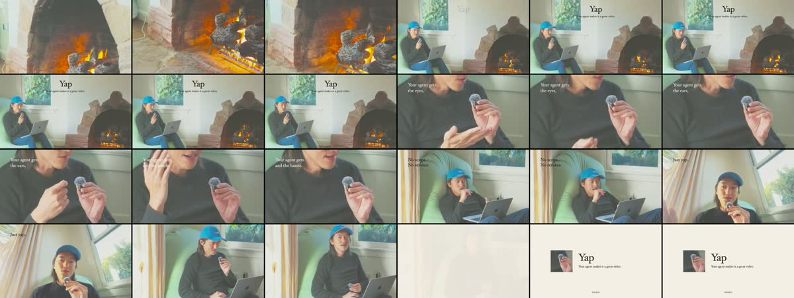
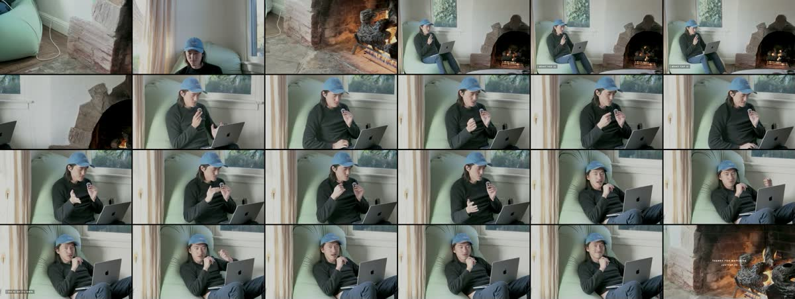
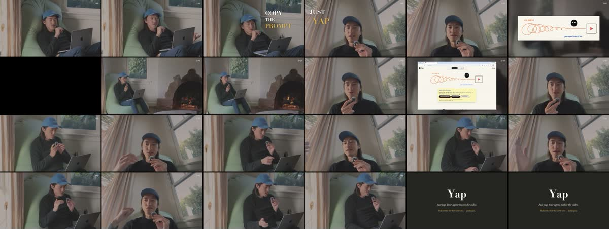

# Presets

## Overview

A preset is a skill-like bundle for one mood of video: grade, music, cut rhythm,
pacing, text, framing and structure. The user gives footage and names a preset;
the agent reads the preset through `yap` and edits that footage into the mood.
Presets ship with the app, refresh themselves from this repository once a day,
and can be authored locally with `preset.create`.

A preset is not part of the consumer [yap skill](../../../skills/yap/SKILL.md).
The skill teaches how to use Yap; a preset teaches one style. The skill only
routes to presets ("A preset is a mood the user chose, not a footage requirement").

Three presets shipped, each named for the general style and learned from one
reference the user picked:

| Preset | First example | Mood |
| --- | --- | --- |
| [`tactile-launch-film`](../../../presets/tactile-launch-film/PRESET.md) | https://x.com/humansand/status/2098115046438215791 | short, wordless, music-led, warm and bright, small serif claims |
| [`on-location-conversation`](../../../presets/on-location-conversation/PRESET.md) | https://x.com/ashebytes/status/2107522974568103969 | faded natural light, long unbroken takes, chapter labels |
| [`studio-podcast`](../../../presets/studio-podcast/PRESET.md) | https://x.com/a16z/status/2110385202581197049 | low-key matte grade, kinetic teaser, calmer multi-camera body |

## Why this shape

**A preset is a mood, not a footage requirement.** A studio-podcast mood on a
holiday film is a valid request. Every preset has `## Any footage` and never
rejects footage or asks for a reshoot; the format refuses a preset without that
section. `## Shoot` is advice, given only when the user asks what to film or hasn't
recorded. `targets.json` marks each measured target `mood` (grade, loudness, cut
rhythm: fix it, or tell the user why it stands when the footage can't reach it) or
`form` (duration, shot count, longest take: a note about the reference that never
fails), because form depends on the footage the user brought. Cut rhythm is the
median shot length, except where a preset checks its parts separately:
studio-podcast's whole-video median is form, and its teaser and body each carry
their own mood median. The first build
treated the references as requirements; the user corrected it, and three
independent agents then proved one set of launch footage could take all three
moods (below).

**A folder, like a skill.** `PRESET.md` is the entry point and links everything
else by relative path: `look.cube` and the `look.json` it was built from,
`targets.json`, `shoot-plan.svg`, extra detail such as studio-podcast's
`cold-open.md`, and one `examples/<slug>/` per reference video. Depth is modelled
on the [isometric-motion skill](../../../presets/authoring/reference/isometric-motion/SKILL.md),
copied in under its MIT license. Each example carries stills, storyboards, motion
filmstrips, a measured `profile.json`, a hand-labelled `sections.json`, a
timeline, colour scopes, music analysis and, where the reference has speech,
speech pacing (numbers only).

**The agent is the customer.** Every preset operation returns `instructions`
(the literal field name the user asked for): ordered steps with real paths and
commands. Documents are referenced by path for depth.

**Media without artificial limits.** A shipped preset may hold as many stills,
audio clips and short video excerpts as help. The only limit is GitHub's: each
file under 100 MiB, so no Git LFS (`raw.githubusercontent.com` serves an LFS
pointer, not the bytes). Full reference videos stay in a local preset's
`examples/<slug>/source/`. In the repository that folder is git-ignored and
refused by the index check, so it is removed before shipping, and the app bundle
drops it too. Shipped presets are public,
so third-party excerpts stay short and each demonstrates one technique.

**Updates like the app.** The service installs the bundled presets at startup,
then refreshes from `main` at startup and every 24 hours. `preset.update` runs the
same refresh now. A failed refresh, including an unreachable source, keeps the
last good copy and reports the error.

**The library never changes.** The user's library is catalog format 29 and must
keep working. Presets live in `~/.yap/presets/`, outside `~/.yap/library`, with
their own version field; `catalogFormat`, the project document and every library
table are unchanged.

## Contracts

### Operations

Shared protocol operations, handled by the service, generated for the CLI and MCP
(`packages/protocol/src/operations.ts`). `preset.*` is unrelated to the encoder
`settings.preset` and to `voice.generate`'s voice `preset`; the descriptions say so.

| Operation | Params | Returns |
| --- | --- | --- |
| `preset.list` | `{}` | installed presets (id, name, description, version, source `bundled`/`downloaded`/`local`, references, id conflicts), the `refresh` state, `instructions`. Never touches the network. |
| `preset.get` | `{ id }` | `PRESET.md` text, folder path, kit path, file list, `instructions` (read the one idea and `## Any footage`; follow `## Edit` on whatever footage was given; `## Shoot` only when the user asks what to film or hasn't recorded; run `## Check` and fix each mood FAIL or tell the user why it stands). |
| `preset.update` | `{ id? }` | the install report, the refresh state, `instructions` naming the presets to re-read. Uses the `drain` wait budget. |
| `preset.create` | `{ name, references? }` | a new **local** preset scaffolded from `authoring/template/`; `{ id, path, guidePath, kitPath, instructions }`. The id is generated from the name. References are https URLs or absolute paths to existing files, recorded in `PRESET.md`, never fetched. |
| `preset.delete` | `{ id }` | moves a **local** preset to the macOS Trash; `{ id, trashedPaths, instructions }`. Official presets are refused with `PRESET_NOT_LOCAL`: the installer owns them and their receipt entries. |

Refusal codes (`packages/protocol/src/refusal-ledger.json`): `PRESET_NOT_FOUND`,
`PRESET_NOT_LOCAL`, `PRESET_NAME_UNUSABLE`, `PRESET_REFERENCE_INVALID`. Download,
checksum and unreachable-source failures are not refusals: they are reported in
the update report's `failed` list and in `refresh.error`, and the previous copy
stays.

### Folder and index

`presets/` mirrors the installed tree: `<id>/` per preset, `kit/` (shared tools
every preset links as `../kit/`) and `authoring/` (the guide `preset.create`
returns). `presets/index.json` is generated by `scripts/presets-index.mjs` and
lists every package (kind `preset`, `kit` or `authoring`) with its version and
each file's bytes and sha256. `--check` refuses:
- a stale index, or a changed package whose version wasn't bumped against the
  merge base;
- a relative link that doesn't resolve to a file inside `presets/` (links across
  packages, such as `../kit/`, are fine);
- symlinks, Git LFS pointers, `source/` folders, files of 100 MiB or more, and an
  id that doesn't match its folder;
- a package whose frontmatter, version, references or required sections are
  invalid;
- an example whose `profile.json` fails a mood target in its preset's
  `targets.json` (section targets such as `targets-teaser.json` are not checked
  against examples).

`PRESET.md` frontmatter is flat (`id`, `name`, `description`, `version`,
`references`); the body requires `## Any footage`, `## Shoot` and `## Edit`.

### Storage

- Bundled: `Yap.app/Contents/Resources/presets/`, copied by `scripts/build-macos.mjs`
  without `source/` folders; `runtime.json` names it as `presetsDirectory`.
  `apps/service/src/main.ts` resolves it (`YAP_PRESETS_DIRECTORY` overrides;
  `YAP_PRESETS_REFRESH=0` turns refresh off).
- Installed: `~/.yap/presets/`. `receipt.json` records each package's version,
  source and commit, plus id `conflicts`; `local.json` is `{ "ids": [...] }`.
- Refresh: resolves `main` to one 40-hex commit with the GitHub API, then streams
  `index.json` and each file from `raw.githubusercontent.com` at that commit, with
  a request timeout and a per-read inactivity timeout but no whole-file limit.

## Principles and invariants

- One owner per concept, in `packages/core/src`:
  - `preset-format.ts` owns the package shape, validation and the id rule
    (`isPackageId`);
  - `preset-install.ts` is the only writer of bundled and downloaded packages and
    of `receipt.json`, and owns precedence;
  - `preset-store.ts` is the only reader of preset content for operations, and
    owns `local.json` (the installer and refresh also read the receipt and
    `local.json` to decide what to install);
  - `preset-remote.ts` owns the pinned GitHub source;
  - `preset-refresh.ts` owns the schedule and joins overlapping runs;
  - `preset-scaffold.ts` owns generated ids and writes new local presets;
    `presets.ts` trashes them;
  - `preset-instructions.ts` holds the `preset.list` and `preset.get` templates;
    `presets/authoring/instructions.md` is the `preset.create` template, so guide
    updates reach new presets without an app release; the short `preset.update`
    and `preset.delete` instructions are written in `presets.ts`;
  - `presets.ts` is the facade the service calls;
  - `presets/kit/check.mjs` is the one oracle for "does this export carry the mood".

  No adapter reads preset files.
- Reads never choose between copies; the installer already chose. A higher
  version replaces the installed copy, a tie keeps it, a local preset is never
  touched, and only `downloaded` packages are removed when the index drops them.
- Install is verify-then-rename: each package is staged, hashed while streaming,
  and swapped in, so a reader never sees a half-installed preset.
- A remote index is untrusted input: ids and kinds outside the format are refused
  before any path is built, and `preset.get` serves only installed or local ids
  matching the id format.
- `preset.create` waits for a refresh in flight and reserves every id in the last
  remote index plus every installed id. A preset published later with the same id
  is recorded as a conflict; the local preset keeps its id.
- A failed bundled install or refresh never stops the service starting.
- Preset operations return text and files only. They never create, edit or export
  a project; the agent decides the edit, following the preset the user chose.
- Committed preset text describes each style in our own words and quotes no
  transcript or script.

## Pointers into the code

- Operations: `packages/protocol/src/operations.ts` (`preset.list` … `preset.delete`);
  service cases in `apps/service/src/project-service.ts`; `PresetError` mapping in
  `apps/service/src/operation-errors.ts`.
- Core tests: `packages/core/src/preset-*.test.ts` and `presets.test.ts` (tampered
  bytes, dropped streams, precedence, conflicts, path traversal, joined refresh,
  close draining a run, id reservation, frontmatter quoting).
- Wire tests in `apps/service/src/project-service.test.ts`: "preset reads cross the
  public wire without changing the catalog format", "presets refresh at startup and
  on preset.update, pinned to one commit, over the public wire", "a local preset is created, read and
  trashed over the public wire".
- Kit: `presets/kit/` (`measure.mjs`, `check.mjs`, `timeline.mjs`, `music.mjs`,
  `pacing.mjs`) each with a `node --test` file, run by the root `test:tools`
  script; `make-look-lut.mjs` has no test of its own (its cubes were checked by
  the export proof). `scripts/presets-index.test.mjs` pins the stale-index,
  version-bump and example-target checks; the tree checks (size, links, symlinks,
  LFS, `source/`, required sections) are pinned in `packages/core/src/preset-format.test.ts`.
- Authoring: `presets/authoring/AUTHORING.md`, `instructions.md` (rendered by
  `preset.create`) and `template/`.
- Routing: `skills/yap/SKILL.md`, `skills/yap/references/capability-catalog.md`
  (Presets), and the `preset-style-routing` case in `evals/cases.json`.

## Proof: one footage, three moods

On 2026-10-17 three independent agents each got the user's launch-video session
footage and one preset with its rendered `instructions`, and nothing about the
others. Every export passed every mood check; form lines came out as notes.

| Preset | Export | Storyboard |
| --- | --- | --- |
| `tactile-launch-film` | 48.5 s, wordless and music-led, the clip-on mic as the made object |  |
| `on-location-conversation` | 2:13, B-roll cold open, two topic chapters as unbroken wides, sign-off over the fire |  |
| `studio-podcast` | 2:01, 32 s kinetic teaser, black beat, two-camera body, dark end card |  |

Both kinds of finding became preset rules in version 5. An unprimed critique of
the frames found: balance outlier shots (fire shots ran hot); hard cuts only in the
studio teaser (a zoom smeared a frame); claim pairs must read as phrases; text
stays off faces, flames and pale areas. The agents' own gaps added: fit the cube with exposure, contrast and saturation trims until the
mood checks pass (a cube alone missed on dark and bright footage); text sized for a
1080-line canvas (px in tactile-launch-film) with fonts that ship with macOS; on-location timing
scaled to length; studio body rhythm checked separately (`targets-body.json`) so
the teaser doesn't skew it.

The grade itself was proven first: `tactile-launch-film/look.cube` on
`fixtures/video-editing-feedback/graham-picture.mov`
([raw, predicted, exported](assets/export-proof/raw-predicted-export.png)). The
Yap export matched the cube simulated in linear sRGB within a few levels, which
confirmed that cubes must be built for linear input.

## Visual provenance

- The three reference videos above are the standard each preset was held to. Their
  measurements and how they were taken are in [study.md](study.md); the stills,
  storyboards and scopes live in each preset's `examples/`.
- The export-proof image puts side by side a frame of the raw fixture, the same
  frame through `tactile-launch-film/look.cube` simulated in linear sRGB, and
  Yap's export of it. It drove the linear-input rule in `make-look-lut.mjs`.
- The storyboards in `assets/launch-footage/` are contact sheets of
  frames sampled across each of the three agents' exports from one footage
  set. They are the evidence that one footage takes all three moods; the user's own
  launch projects were left untouched.

## Dead ends

- **Links only, no media.** The first answer was "just store the x link". The user
  then widened it to as many stills, audio and short videos as help, with no cap
  but GitHub's per-file limit.
- **Presets named for their source** (`a16z-podcast`). Replaced by general style
  names, with each source as an example.
- **A per-version install path.** It broke every preset's `../kit/` link; the
  installed tree mirrors the repo instead.
- **Reading two places with precedence on every read.** One installed tree owns
  precedence in one place.
- **A native Trash bridge.** `/usr/bin/trash` ships with macOS 26. `instructions`
  say the preset can be restored from Finder (it is an ordinary item in the Trash);
  Finder's Put Back to the original folder was not verified.
- **Grading cubes in display space.** Yap applies LUTs in linear sRGB, so
  `make-look-lut.mjs` encodes, grades, then decodes.
- **A per-read timeout scaled to file size.** Replaced by a fixed inactivity
  timeout; a large file may take long, a stalled one may not.
- **Footage requirements in presets** (see Why this shape).

## Limits and open questions

- Index authenticity rests on HTTPS and repository access, like the pinned skill
  fetch. An Ed25519 index signature is the named option before presets come from
  anyone but us.
- With no per-preset cap, a first refresh can download a lot. If that proves slow,
  fetch large media on first `preset.get`. Measure before adding it.
- Lighting can't be graded in: a low-key mood on bright footage comes out matte,
  not dark. tactile-launch-film and studio-podcast say so in `## Limits`.
- Yap gaps the trial hit, outside this spec: text has no letter-spacing;
  overlapping text clips each need their own track; `edit.apply` labels resolve
  only within one request; the bundled ffmpeg lacks `drawtext`, `eq` and `boxblur`;
  `kit/measure.mjs`'s default scene threshold misses cuts between similar framings
  (agents pass `--scene 0.2`).

Implementation decisions are in [choices.md](choices.md).
